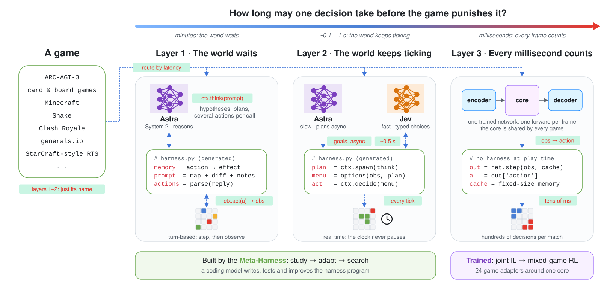
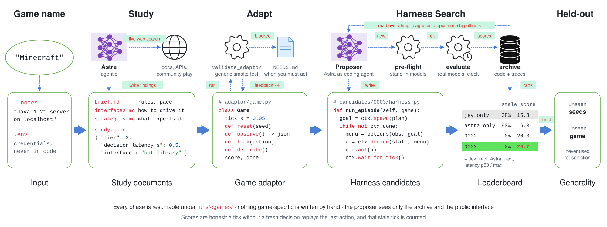
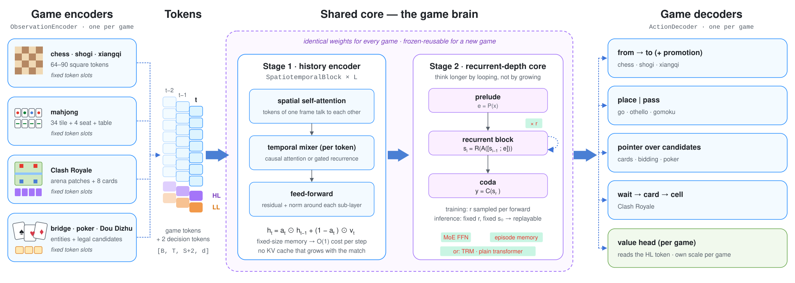
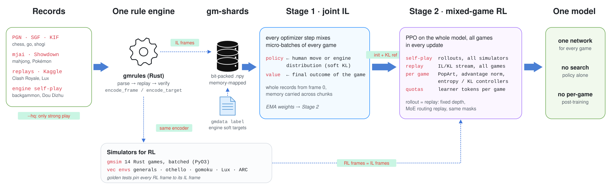

<h1 align="center">GamingMaster</h1>

<h3 align="center">
Game-playing AI agents for any game: foundation models where there is time to think,<br>
one trained multi-game network where there is not.
</h3>

<p align="center">
  <a href="LICENSE"></a>
  
  
  
  <a href="https://github.com/sunyxedu/GamingMaster/actions/workflows/ci.yml"></a>
</p>

<p align="center">
  <a href="#three-layers-ordered-by-decision-latency">Three layers</a> ·
  <a href="#installation">Installation</a> ·
  <a href="#quickstart">Quickstart</a> ·
  <a href="#the-meta-harness-layers-1-and-2">Meta-Harness</a> ·
  <a href="#the-multi-game-network-layer-3">Multi-game network</a> ·
  <a href="#citation">Citation</a>
</p>

<p align="center">
  
</p>

GamingMaster is a research framework for building game-playing agents across very different
games: ARC-AGI-3 puzzles, Minecraft, chess, Go and shogi, riichi mahjong, Pokémon Showdown,
contract bridge, poker, Dou Dizhu, Lux AI, Clash Royale and real-time strategy. A single
agent design does not cover this range. A frontier reasoning model can work out the hidden
rules of a puzzle, but it needs tens of seconds per call and loses a real-time game before
its first answer arrives. A small trained network answers in milliseconds, but it cannot
read the rules of a game it has never seen.

GamingMaster therefore sorts games by one property, **how long a single decision may take
before the game punishes it**, and builds the agent from whatever fits in that budget. When
there is time to think, foundation models play. The program that connects them to the game,
the *harness*, is written, tested and improved by an outer loop, the **Meta-Harness**, which
starts from nothing but the game's name. When there is no time, one neural network plays.
Its core is shared by every game, and it is trained jointly on all of them: imitation
learning from strong play first, then mixed-game reinforcement learning.

## Three layers, ordered by decision latency

**Layer 1: the world waits.** In turn-based games, puzzles and most card games nothing
happens until the agent acts, so every decision can go to a strong reasoning model (System 2;
*Astra* in the default configuration). Speed is not the limit here. The limits are memory
and budget: the model has to discover rules nobody told it from a handful of observations,
remember what each action did, and spend a few dozen calls well. The harness for such a game
decides what to store, what to show the model on each turn (a diff, a map with a legend,
the hypotheses still standing), how many actions to commit per call, and when a cheap
scripted probe is better than asking. ARC-AGI-3 is the reference testbed.

**Layer 2: the world keeps ticking.** Once the game runs on its own clock, as in Minecraft,
Snake or action games with 0.1–1 s of slack, a minute of reasoning means the game plays
itself in the meantime. The moment-to-moment choices move to a fast model: *Jev*,
[TypeSafe](https://docs.typesafe.ai)'s System-1 model, which answers typed questions
(choice, score, yes/no) about a JSON state with calibrated probabilities in about half a
second and many questions per request. The slow model keeps thinking in the background and
sets goals. The harness now has to design the bridge in both directions: how a plan becomes
a state and a set of questions Jev can answer, how Jev's answer becomes a legal action,
when to ask the slow model again, and what to do when a decision arrives late.

**Layer 3: every millisecond counts.** When a match holds hundreds of decisions, each due
within tens of milliseconds (Clash Royale, StarCraft-style RTS, generals.io), no language
model fits in the loop. The agent is a trained network that maps each frame to an action in
one forward pass and carries a fixed-size memory of the match so far. GamingMaster does not
train one network per game. It trains one shared core, a *game brain*, with thin per-game
encoders and decoders around it, so that what the core learns in chess or mahjong is
available to the next game.

The layer is a property of the game rather than a choice of the user. For layers 1 and 2,
the Meta-Harness's study phase estimates a new game's decision latency and assigns the
layer itself (`"tier"` in `study.json`).

## Installation

GamingMaster runs on macOS and Linux with Python 3.10+ and a stable Rust toolchain
([rustup.rs](https://rustup.rs)). [uv](https://docs.astral.sh/uv/) manages the environment
and builds the Rust simulators as part of the install.

```bash
git clone https://github.com/sunyxedu/GamingMaster.git
cd GamingMaster
uv sync                    # Python environment + the gmsim Rust simulators (PyO3)
uv sync --extra arc3       # optional: the ARC-AGI-3 SDK (Python 3.12+)
uv sync --extra lux        # optional: the official Lux AI Season 3 environment (JAX)

cd data_processing && cargo build --release && cd ..   # gmdata / crdata data pipelines
```

Live model runs need credentials, which are only ever read from `.env`
(see [`.env.example`](.env.example)). Astra runs through the Codex CLI's own login.
Jev needs `TYPESAFE_API_KEY`. Which model sits behind each role is configuration in
[`metaharness/models.toml`](metaharness/models.toml) (profiles `astra`, `sol`, `claude`,
`claude-opus`, `jev`, and offline stand-ins), so no model name is hard-coded in the code.

## Quickstart

**Check the whole Meta-Harness pipeline offline.** Scripted models on a virtual clock
exercise proposal, pre-flight, evaluation, archiving and held-out evaluation in seconds,
without network access or keys:

```bash
uv run python -m metaharness loop --tier 2 --game snake \
    --system1 heuristic --system2 scripted --proposer scripted --clock virtual --iters 1
```

**Build an agent from a game's name.** The `run` command studies the game on the web,
writes and validates an adaptor for it, and then searches for a harness. Everything it
produces lands in `runs/<game>/`, and a rerun resumes where the last one stopped:

```bash
uv run python -m metaharness run --game "Minecraft" --notes "Java 1.21 server on localhost"
uv run python -m metaharness run --game "ARC-AGI-3" --tier 1
```

If the game needs something only you can provide, such as an account login or a missing
environment variable, the adapt phase stops and lists it in `runs/<game>/adaptor/NEEDS.md`.
A single harness file can also be scored on its own:

```bash
uv run python -m metaharness eval --tier 2 --game snake \
    --harness metaharness/baselines/tier2_jev_only.py --system1 jev --system2 none --seeds 0,1,2
```

**Train the multi-game network.** Data comes from the Rust converters as memory-mapped
gm-shards. Stage 1 trains one network on every game at once, and Stage 2 continues the same
network with mixed-game RL:

```bash
G=data_processing/target/release/gmdata
$G othello fetch --first-year 2000 --out data/othello/wthor
$G othello convert --hq --input data/othello/wthor --out data/othello/train
$G chess fetch --month 2021-06 --elite            # see `$G chess convert --help`

# Stage 1: joint imitation learning, every optimizer step mixes every game
uv run python -m training.train_multi_game \
    --data othello=data/othello/train --data chess=data/chess/train \
    --steps 20000 --override moe_experts=8

# Stage 2: PPO on the whole model, rollouts and IL replay of all games in each update
uv run python -m training.train_rl_joint --init checkpoints/multi/multi_final.pt \
    --rl othello --data othello=data/othello/train --data chess=data/chess/train

# A new game around the trained brain: only its encoder, decoder and value head train
uv run python -m training.train_multi_game --data go=data/go/train \
    --init_core checkpoints/multi/multi_final.pt --freeze_core --train_core_norms
```

Every trainer runs data-parallel under `torchrun --standalone --nproc_per_node=N`. Slurm job
scripts are in [`scripts/slurm/`](scripts/slurm/README.md), and the fetch/convert recipe for
every game is in [`data_processing/README.md`](data_processing/README.md).

## The Meta-Harness (layers 1 and 2)

<p align="center">
  
</p>

For layers 1 and 2 the models are fixed, and what decides the score is the code around
them: what the reasoning model sees, how its reply becomes actions, how the fast model is
questioned. That code is different for every game and tedious to write by hand, so the
Meta-Harness writes it. It follows *Meta-Harness: End-to-End Optimization of Model Harnesses*
([arXiv 2603.28052](https://arxiv.org/abs/2603.28052)) and extends it in two directions:
the search starts from a bare game name, and it runs on real-time games where model latency
is part of the score.

### What a harness is

A harness is one Python file with `build(ctx)` returning a program with
`run_episode(game)`. It owns the whole control loop of an episode, and everything it may use
comes through `ctx` ([`metaharness/core/contract.py`](metaharness/core/contract.py)). A
layer-2 harness has roughly this shape:

```python
def build(ctx):
    return Harness(ctx)

class Harness:
    def __init__(self, ctx):
        self.ctx = ctx

    def run_episode(self, game):
        ctx = self.ctx
        plan = ctx.spawn(lambda: ctx.think(game.describe()))   # Astra, in the background
        while not ctx.done:
            state, questions = self.menu(game.observe(), plan)  # built by code from the observation
            answer = ctx.decide(state, questions)               # Jev: typed, ~0.5 s
            ctx.act(self.to_action(answer))                     # posted to the game's mailbox
            ctx.wait_for_tick()
```

`ctx.think` and `ctx.decide` are the only way to reach a model, so the evaluator accounts for
every call against a per-episode budget. `ctx.memory` is reset per episode unless an
experiment explicitly declares shared memory, and the game view exposes only what a real
client would: `describe()`, an action spec, JSON observations and the score.

### From a name to a harness

The pipeline runs in three phases, each validated before the next starts. In the **study**
phase an agentic Astra researches the game with live web search and writes the rules and
pace (`brief.md`), every way to drive the game programmatically together with the chosen
one (`interfaces.md`), what strong players do and whether it belongs in code, in Astra's
prompts or in Jev's questions (`strategies.md`), and a machine-readable summary that
includes the layer and the decision latency (`study.json`). In the **adapt** phase Astra
builds `adaptor/game.py` against that interface. It may install software and start servers:
for Minecraft it set up a vanilla 1.21.1 server with a Mineflayer bridge. A generic smoke
test (`validate_adaptor`) then loads the adaptor, resets two seeds, applies every action and
checks observations, scores and scenario variety, and its report goes back to the agent for
up to four attempts.

The **search** phase is the outer loop. The proposer, Astra working as a coding agent inside
the run directory, reads the whole archive (every earlier harness, its proposal, its
scores and its complete JSONL traces of model calls and game ticks), states a hypothesis
about the current best harness's failure, and writes one new candidate. Before any real model
budget is spent, the candidate is *pre-flighted*: one short episode on a virtual clock with
stand-in models that return garbage, with one repair round if it crashes. It is then
evaluated with the real models on training seeds, and the leaderboard is regenerated. After
the last iteration the best candidate is re-evaluated on held-out seeds and, optionally, on
a held-out game with different rules and observation keys. The selection never sees those
scores. With several training games, candidates are ranked by their mean min-max-normalised
score and then by their worst game, so a harness that wins one game and crashes on another
does not beat one that is decent everywhere.

### Why the clock matters

A real-time game ticks on its own clock, whether or not the harness has decided. A tick
without a fresh action re-applies the last one, and the runner counts it as *stale*. Every
model call's latency is recorded next to the score, together with the share of actions that
followed a fresh Jev or Astra answer (`Jev→act`, `Astra→act`). A harness that thinks too
long therefore scores what it deserves: Astra alone on a real-time game leaves more than
90% of ticks stale. In `wall` mode a thread ticks the game in real time. In `virtual` mode a
deterministic discrete-event clock charges each call's latency to the game, and a background
Astra call overlaps with the Jev calls made meanwhile exactly as it would in wall time,
which makes tests and cheap experiments reproducible.

### Results so far

These are the first end-to-end runs from a game name, with Astra at high reasoning effort
and the real Jev. The archives in [`metaharness/artifacts/`](metaharness/artifacts/README.md)
hold every proposal, harness, score and generated adaptor.

| Input | Layer | Baselines (train seeds) | Best found harness | Held-out |
|---|---|---|---|---|
| `"Snake"` | 2 | Jev only 0.00 · Astra only 0.00 | **0.77** (0% stale ticks) | 0.65 on unseen seeds |
| `"ARC-AGI-3"` (offline) | 1 | Astra, one action per call: 0.33 levels | **4.33** levels | 2.5 levels on unseen games |
| `"Minecraft"` (Java 1.21.1) | 2 | Jev only 15.3 · Astra only 6.3 (93% stale) | **26.7**, 31% of actions Jev-informed | – |

In Minecraft the proposals show why the harness matters. The first one asked Astra to
compile a complete guarded policy, which never arrived in time, so the agent only survived
idle. The next one had code build short menus of grounded commands from each observation,
let Jev choose among them every tick, and let Astra set goals asynchronously. That is the
first harness in which the score comes from progress (gathered resources, crafted tools)
rather than from survival.

## The multi-game network (layer 3)

<p align="center">
  
</p>

A frame of any game becomes a fixed set of tokens: squares of a board, tile kinds and seats
in mahjong, arena patches and deck cards in Clash Royale, or the entities and the legal
candidate actions of a card game. Two learned decision tokens are appended to them (HL and
LL). **Stage 1** encodes history. Each spatiotemporal block lets the tokens of one frame
attend to each other, then mixes every token position over time, either with causal
attention or with a gated linear recurrence whose state has a fixed size. **Stage 2** is the
thinking core. By default it is a recurrent-depth transformer
([Geiping et al., 2025](https://arxiv.org/abs/2502.05171)): a prelude, one block looped
*r* times, and a coda, optionally with DeepSeek-V3-style Mixture-of-Experts feed-forward
layers and with episode-memory sub-layers. A Tiny Recursive Model
([TRM](https://arxiv.org/abs/2510.04871)) core and a plain deep transformer are available
through the same configuration. Per-game decoders then read the result: from-to moves for
chess-like games, placement or pass for Go-like games, a pointer over the candidates for
card and bidding games, and a wait, card, cell hierarchy for Clash Royale. A value head per
game reads the HL token.

Most of the design follows from three requirements.

**The core must be reusable.** The long-term goal is one strong game brain that a new game
can use by training only its own encoder and decoder. Everything game-specific therefore
stays outside the core. That includes the token layout, the action structure and the value
head, whose targets have a different scale and meaning in every game. The core configuration
must agree across all games, and memory sub-layers start as exact identities so that they
can join an already trained core.

**The policy alone must be strong.** GamingMaster uses no tree search at play time. Search
is specific to each game and breaks down under hidden information, so it cannot live in a
shared core. The strength has to come from what the network learns from: strong human play,
engine teacher distributions where engines exist (`gmdata label` adds Stockfish, KataGo,
Egaroucid, YaneuraOu or Pikafish soft targets to the shards), and reinforcement learning.

**Acting must be fast and exactly replayable.** A layer-3 agent acts every few tens of
milliseconds, so `net.step` carries a fixed-size memory instead of a key-value cache that
grows with the match, has static shapes and can be captured as a CUDA graph. For PPO the
learner must see the same distribution the actor sampled from, so the inference depth is
fixed, the recurrent core's initial state is deterministic, MoE routing is replayed from the
rollout, and sampling, replay and imitation targets go through one masked code path per
decoder.

### Data and training

<p align="center">
  
</p>

Every game's rules are written once, in Rust ([`gmrules`](data_processing/rs/gmrules)), and
that one implementation serves two consumers. The converters parse source records (PGN,
SGF, mjai, Showdown logs, replays), replay every move through the rules, check the recorded
results, and write the decision frames as bit-packed gm-shards. The simulators
([`gmsim`](data_processing/rs/gmsim/README.md), batched and exposed to Python via PyO3) encode
their frames with the same functions, so a reinforcement-learning frame is identical to the
imitation frame of the same position. Golden tests pin this equality. Each converter also
has a `--hq` preset that keeps only strong play.

Training then runs in two stages on the same whole model. **Stage 1** is joint imitation
learning, in which every optimizer step contains micro-batches of every game; long records
can be trained whole from their first frame, with the memory carried across chunks.
**Stage 2** is mixed-game PPO ([`training/train_rl_joint.py`](training/train_rl_joint.py)).
It starts from the Stage-1 EMA weights and keeps them as a frozen KL reference, rolls out
the games that have simulators, and mixes an imitation replay stream of every game into
each update. Because the games' reward scales differ by orders of magnitude, value targets
are normalised with per-game PopArt, advantages with per-game statistics, and entropy and KL
coefficients have per-game controllers. A token-quota scheduler keeps any single game from
crowding out the others. There is no per-game post-training: the result is one network for
every game.

### Supported games

| Family | Games | Training data |
|---|---|---|
| Board, perfect information | chess, chess variants (Chess960, crazyhouse, atomic, …), shogi, xiangqi, Go, Othello, Gomoku, Breakthrough | Lichess, KGS, floodgate, WTHOR, Gomocup, CCPD; engine labels |
| Cards and bidding, hidden information | riichi mahjong, contract bridge, heads-up no-limit hold'em, Skat, Dou Dizhu, Kuhn poker; a Hearthstone-style adapter | Tenhou Houou, WBridge5 / Ben, ACPC, ISS, DouZero self-play |
| Chance and simultaneous moves | backgammon, Pokémon Showdown singles, Goofspiel, Pig | gnubg self-play, Showdown ladder replays |
| Real-time strategy | generals.io, Lux AI Season 3, Clash Royale; a StarCraft-style adapter | generals.io ladder, top-team Kaggle episodes, ranked replays |
| Visual puzzles | ARC-AGI-3 | the official offline SDK |

All 24 games have network adapters (`model.games.build_game_network(name)`), and 19 have RL
environments. The Meta-Harness side needs no per-game code at all: its testbeds (`snake`,
`lanerunner`, `rulepuzzle`, `arc3`) exist only to test the pipeline.

## Repository layout

```text
GamingMaster/
├── metaharness/        layers 1–2: CLI, study/adapt phases, harness contract, runner, archive, model backends
│   └── artifacts/      published experiment archives (harnesses, proposals, scores, generated adaptors)
├── model/              layer 3: shared core (model/components), per-game adapters (model/games)
├── env/                vectorised RL environments and seat/opponent control (league)
├── training/           single-game and joint IL, single-game and mixed-game RL, arena evaluation
├── data_processing/    Rust workspace: gmrules (rules), gmdata / crdata (pipelines), gmsim (simulators), gmshard
├── scripts/            data fetching, probes, visualisation, Slurm jobs
└── tests/              unit, golden-parity and end-to-end tests (`uv run pytest tests/ -q`)
```

## Citation

If GamingMaster is useful in your research, please cite it:

```bibtex
@software{sun2026gamingmaster,
  author = {Sun, Yuxuan},
  title  = {GamingMaster: Latency-Tiered Game Agents with a Meta-Harness and a Shared Multi-Game Network},
  year   = {2026},
  url    = {https://github.com/sunyxedu/GamingMaster}
}
```

GamingMaster builds on Meta-Harness ([arXiv 2603.28052](https://arxiv.org/abs/2603.28052)),
recurrent-depth transformers ([arXiv 2502.05171](https://arxiv.org/abs/2502.05171)), the Tiny
Recursive Model ([arXiv 2510.04871](https://arxiv.org/abs/2510.04871)), DeepSeek-V3 routing
([arXiv 2412.19437](https://arxiv.org/abs/2412.19437)), gated delta networks
([arXiv 2412.06464](https://arxiv.org/abs/2412.06464)), multi-task PopArt
([arXiv 1809.04474](https://arxiv.org/abs/1809.04474)) and AlphaStar's recipe of imitation
learning followed by self-play RL with a KL anchor.

## License

The source code is released under the [Apache License 2.0](LICENSE).

`gmrules` links [shakmaty](https://github.com/niklasf/shakmaty) (GPL-3.0-or-later) for
the chess variants, so the `gmdata` and `gmsim` binaries built from it are GPL-3.0-or-later
combined works. External engines (Stockfish, KataGo, Egaroucid, gnubg, …) run as separate
processes and are never vendored. Datasets keep their own terms, and some of them (for
example the Tenhou logs) must stay private. See
[`data_processing/README.md`](data_processing/README.md) for each source.
