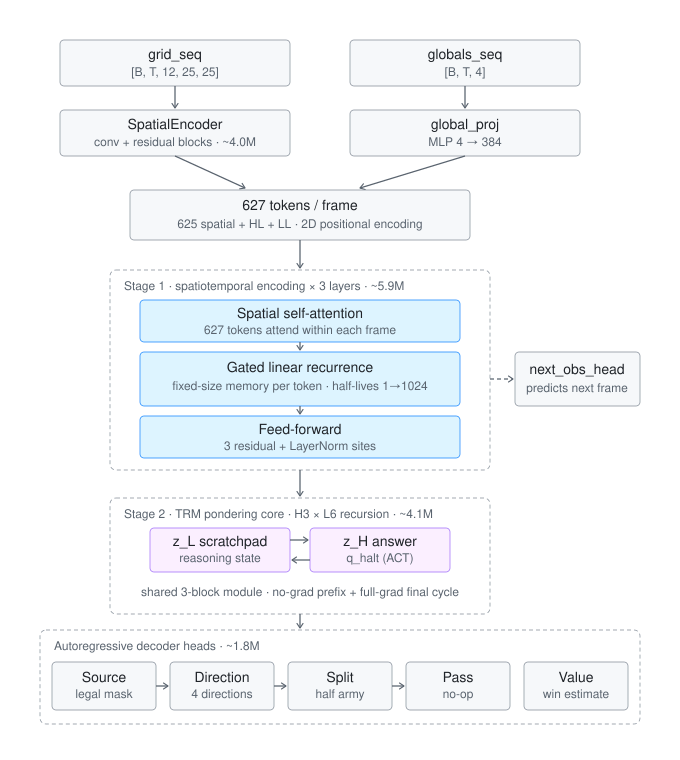

# GamingMaster — Multi-Game Neural Network Bot

An AlphaStar-inspired Transformer architecture with a TRM (Tiny Recursive Model) pondering core, trained by Imitation Learning (IL) followed by PPO self-play (RL).

The core network is **game-agnostic**: a fixed two-stage trunk (spatiotemporal history encoder + TRM pondering) with pluggable per-game observation encoders and action decoders. [generals.io](https://generals.io) is the fully-trained reference game (data pipeline + RL environment + trained checkpoints); model adapters also exist for chess, Go, Othello, Gomoku, Shogi (pieces-in-hand drops), Riichi Mahjong, Pokémon (Showdown singles), Lux AI–style simultaneous multi-unit games, Clash Royale, Hearthstone, and StarCraft-style RTS — see [docs/multi-game.md](docs/multi-game.md) and the per-game data/environment survey in [docs/game-data-sources.md](docs/game-data-sources.md).

```python
from model.games import build_game_network

net = build_game_network("chess", d_model=256)   # generals / chess / go / othello / gomoku / shogi /
net = build_game_network("go", board_h=9)        # mahjong / pokemon / lux / clash_royale / hearthstone / starcraft
```

Detailed docs: [training guide](docs/training.md) · [data pipeline](docs/data-pipeline.md) · [multi-game architecture](docs/multi-game.md) · [game data sources](docs/game-data-sources.md) · [known limitations](docs/known-limitations.md)

## Project Structure

```
├── data_processing/          # Replay data pipelines
│   ├── download/             #   generals.io: S3 download + LZ-string decompression
│   ├── processing/           #   generals.io: simulator, filter, data models
│   ├── parsers/              #   generals.io: simulator output → training format
│   ├── dataset_seq.py        #   generals.io: PyTorch Dataset + collate
│   ├── games/                #   Multi-game pipelines → shared shard format
│   │   ├── dataset.py        #     shard format + GameShardDataset + collate
│   │   ├── chess/            #     Lichess PGN/zst → shards (+ fetch script)
│   │   ├── go/               #     SGF → shards (own rules engine, ko/captures)
│   │   ├── othello/          #     WTHOR → shards (exact rules, pass insertion)
│   │   ├── shogi/            #     floodgate CSA → shards (python-shogi replay)
│   │   ├── mahjong/          #     Tenhou mjai .mjson → decision-point shards
│   │   ├── pokemon/          #     Showdown replay JSON → observer-view shards
│   │   └── lux/              #     Kaggle Lux AI S3 episodes → per-match shards
│   └── mock/                 #   Mock data generators for testing
├── model/                    # Neural network
│   ├── config.py             #   ModelConfig dataclass (core config; game configs subclass it)
│   ├── game_network.py       #   GameNetwork — game-agnostic two-stage core
│   ├── network.py            #   GeneralsNetwork (generals adapter, legacy API + checkpoints)
│   ├── losses.py             #   ImitationLoss, RLLoss
│   ├── rl_utils.py           #   GAE, RolloutBuffer, KL reg, freeze helpers
│   ├── games/                #   Game adapters (encoder + decoder per game)
│   │   ├── base.py           #     ObservationEncoder / ActionDecoder interfaces, PointerHead
│   │   ├── registry.py       #     build_game_network("chess" | "go" | ...)
│   │   ├── generals.py       #     grid conv encoder + Source/Dir/Split/Pass decoder
│   │   ├── board.py          #     BoardEncoder + FromToDecoder (chess) / PlacementDecoder (Go)
│   │   ├── shogi.py          #     board + pieces-in-hand encoder, move-or-drop decoder
│   │   ├── mahjong.py        #     tile-kind/player/table tokens + typed action decoder
│   │   ├── pokemon.py        #     pokemon-slot encoder + move/switch decoder
│   │   ├── lux.py            #     map conv + unit slots, simultaneous per-unit decoder
│   │   ├── clash_royale.py   #     arena conv + hand tokens + card/placement decoder
│   │   ├── hearthstone.py    #     entity-slot encoder + typed actor/target decoder
│   │   └── starcraft.py      #     minimap conv + unit slots + AlphaStar-lite decoder
│   └── components/           #   Reusable building blocks
│       ├── encoder.py        #     SpatialEncoder, ResBlock
│       ├── transformer.py    #     SpatiotemporalBlock (attention/recurrent temporal mixer)
│       ├── recurrence.py     #     GatedRecurrence — fixed-size neural episode memory
│       ├── trm.py            #     TRM (Tiny Recursive Model) two-state pondering
│       ├── heads.py          #     Source / Direction / Split / Pass / Value heads
├── env/                      # RL environments
│   ├── generals_env.py       #   Two-player simultaneous-move Gym-like env
│   └── board_selfplay_env.py #   Alternating-move self-play env (othello/gomoku)
├── scripts/
│   ├── prepare_data.py       # CLI: unified resumable pipeline (fetch→filter→simulate→convert)
│   ├── replay_to_visual.py   # CLI: download one replay → simulate → HTML viewer
│   ├── play_model.py         # CLI: model plays on a real replay map (vs replay opponent)
│   ├── simulate_model.py     # CLI: compare model predictions to human moves
│   ├── view_rl_replay.py     # CLI: RL self-play replay JSON → HTML viewer
│   └── check_training_memory.py  # CLI: memory probe at real model shapes
├── docs/                     # Training guide, data pipeline, known limitations
├── train_il.py               # generals.io IL training (world model, multi-node)
├── train_il_game.py          # Generic IL trainer for every other game adapter
├── train_rl.py               # generals.io RL (PPO self-play + IL regularisation)
├── train_rl_game.py          # PPO self-play for placement board games (othello/gomoku)
├── tests/
│   ├── test_verify_simulator.py       # Simulator correctness (real replay)
│   ├── test_model.py                  # Unit tests for every model component
│   ├── test_audit_fixes.py            # 13 bug-fix regression tests
│   ├── test_comprehensive_audit.py    # Comprehensive audit tests (all modules)
│   ├── test_training_e2e.py           # End-to-end training loop tests
│   ├── test_rl.py                     # RL utilities and rollout tests
│   ├── test_games_*.py                # Per-game adapter tests (+ registry)
│   ├── test_pipeline_*.py             # Per-game data-pipeline tests (real-format fixtures)
│   └── test_train_il_game.py          # Shared shard dataset + generic trainer tests
└── pyproject.toml
```

## Quick Start

### 1. Install

```bash
uv sync

# (Node.js is NOT required — .gior decompression is pure Python)
```

### 2. Visualise a Replay

```bash
# From a generals.io replay URL — produces an interactive HTML file
uv run python scripts/replay_to_visual.py \
    --url "https://generals.io/replays/asS2S5O_y?p=%7EHemlix%7E"

# Open in browser (← → keys to step, Space to play/pause)
open viz_output/replay.html
```

### 3. Prepare Training Data

```bash
uv run python -m scripts.prepare_data --players Human.exe --output data/output --target 1000 --min-turns 80
```

### 4. Train (Imitation Learning)

```bash
# Recommended: recurrent neural memory + world-model objective
uv run python train_il.py \
    --data_dir data/output/training/Human.exe \
    --temporal_mixer recurrent --world_model_weight 0.2 \
    --tf_start 0.4 --tf_end 0.0 \
    --batch_size 4 --grad_accum 4
```

Effective batch = `batch_size × GPUs × grad_accum`; see
[docs/training.md](docs/training.md) for memory-based batch sizing and the
full from-scratch recipe.

### 5. Train (Reinforcement Learning)

```bash
# Load from IL checkpoint, fine-tune with PPO self-play
uv run python train_rl.py \
    --il_checkpoint checkpoints/checkpoint_epoch50.pt \
    --il_data_dir data/output/training/MeltedToast
```

> RL training uses PPO self-play with joint IL regularisation (AlphaStar-style).
> Environment: `env/generals_env.py` provides a two-player simultaneous-move Gym-like environment with fog of war.
> Model-side support: `model.step()` single-step inference with KV cache, `ValueHead`, `RLLoss` (PPO), `rl_utils.py` (GAE, RolloutBuffer, KL regularisation).

---

## How It Works — Step by Step

### Step 1: Data Pipeline

The data pipeline turns raw generals.io replays into training-ready tensors.

**Download** — `data_processing/download/`

Replays are stored on AWS S3 as `.gior` files (LZ-string compressed). The pipeline:
1. Fetches replay metadata from `generals.io/api/replaysForUsername`
2. Downloads `.gior` files from `generalsio-replays-na.s3.amazonaws.com`
3. Decompresses using Node.js `lz-string` (auto-installed if missing)
4. Deserialises into a structured dict: map size, generals, cities, mountains, moves

**Filter** — `data_processing/processing/filter.py`

Keeps only useful replays: 1v1 games, minimum turn count, optionally minimum opponent rating.

**Simulate** — `data_processing/processing/simulator.py`

Replays the game tick-by-tick from one player's perspective, producing per-turn:
- **State encoding** (11 categories × 25×25 grid): what the player sees through fog of war
- **Army counts** (25×25 grid): troop numbers on visible tiles
- **Global stats**: my army, my land, opponent army, opponent land
- **Actions**: the move the player made (source, destination, split flag)

Key game rules implemented:
| Rule | Implementation |
|------|---------------|
| Army growth | Generals/cities: +1 every 2 ticks. All land: +1 every 50 ticks |
| Fog of war | Owned tiles + 8 adjacent tiles visible |
| Move priority | Heuristic: Chase > Defensive > Army size, general attacks last (known approximation — see [docs/known-limitations.md](docs/known-limitations.md)) |
| Capture | Attacker wins if moving army > defender army; difference remains |
| 50% split | Moves ⌊army/2⌋ instead of army−1 |
| Dropped moves | Moves invalid at execution time (stale source, mountain target) are dropped like the real server and excluded from labels (`count=-1`) |
| Surrender | Games without a general capture resolve the winner from the `afks` array |

Replays the simulator cannot reproduce faithfully are rejected: maps larger than 25×25, modern map features (swamps, deserts, lookouts, …) and game modifiers. See [docs/data-pipeline.md](docs/data-pipeline.md).

**Convert** — `data_processing/parsers/generals_json.py`

Transforms simulator output into the training format. **Critical detail**: the converter correctly pairs observation at time *t* with the action at time *t+1*, because the player decides their next move *after* seeing the current state. (This off-by-one was a bug that was found and fixed — verified by checking that 100% of action sources fall within the legal-move mask of the paired observation.)

Training format per timestep:
| Field | Shape | Description |
|-------|-------|-------------|
| `grid_seq` | `[T, 12, 25, 25]` | 11 one-hot state channels + 1 log-normalised army channel |
| `globals_seq` | `[T, 4]` | log-normalised (myArmy, myLand, opArmy, opLand) |
| `legal_source_mask_seq` | `[T, 1, 25, 25]` | bool mask — owned tiles with army > 1 |
| `count` | `[T]` | 1 = executed move, 0 = deliberate pass, −1 = server-dropped move (excluded from loss) |
| `src_y`, `src_x` | `[T, K]` | source tile coordinates |
| `dir_id` | `[T, K]` | direction: 0=↓ 1=→ 2=↑ 3=← |
| `ratio_id` | `[T, K]` | 0=all-but-1, 1=50% split |
| `value` | `[T]` | heuristic game value ∈ \[−1, 1\] |

### Step 2: Neural Network Architecture



The model uses a **factored spatiotemporal backbone**: each layer first does spatial self-attention within the current timestep, then mixes across timesteps at each grid position — via a gated linear recurrence (fixed-size neural memory, the recommended mode) or causal temporal attention (`temporal_mixer`). A next-observation head pressures the recurrent state to actually retain what it saw; the TRM core then ponders the belief state before the autoregressive action heads decode a move.

Two temporal modes are available via `ModelConfig.temporal_type`:

| Mode | `temporal_type` | Description |
|------|----------------|-------------|
| **Spatiotemporal** (the only mode) | `"spatiotemporal"` | Factored spatial attention + temporal mixer (`n_st_layers`) → TRM pondering |

```
  grid_seq [B,T,12,25,25]              globals_seq [B,T,4]
  (11 one-hot state + 1 army)          (myArmy, myLand, opArmy, opLand)
          │                                     │
          ▼                                     ▼
  ┌───────────────────┐                ┌─────────────────┐
  │  SpatialEncoder   │                │   GlobalProj    │
  │  Conv + ResBlocks │                │  Linear→ReLU    │
  │  ×2               │                │  →Linear        │
  └────────┬──────────┘                └────────┬────────┘
           │ [B*T, d, 25, 25]                   │ [B*T, d]
           │                          broadcast │ → [B*T, d, 1, 1]
           └──────────── + ─────────────────────┘
                         │ [B, T, d, 25, 25]
                         ▼
                  flatten to [B, T, 625, d]
                         │
                  append learnable tokens:
                    HL (High-Level → value)
                    LL (Low-Level  → direction/split)
                         │ [B, T, 627, d]
                         │
                  + 2D spatial PE  (learnable row + col embeddings)
                  + sinusoidal temporal PE
                         │
                    ┌─────────┐
                    │pre_norm │ LayerNorm
                    └────┬────┘
                         ▼
  ┌──────────────────────────────────────────────────────────────┐
  │  Stage 1: SpatiotemporalBlock × n_st_layers  (separate wts)  │
  │                                                              │
  │  ┌─ Spatial Self-Attention ──────┐   627 tokens within each  │
  │  │  Add & Norm                   │   timestep interact       │
  │  ├─ Temporal Self-Attention ─────┤   per position across all │
  │  │  (causal: t sees 0..t only)   │   past timesteps          │
  │  │  Add & Norm                   │                           │
  │  ├─ MLP (d → d_ff → d) ──────────┤                           │
  │  │  Add & Norm                   │                           │
  │  └───────────────────────────────┘                           │
  └──────────────────────┬───────────────────────────────────────┘
                         │ [B, T, 627, d]
                    ┌─────────┐
                    │mid_norm │ LayerNorm
                    └────┬────┘
                         ▼
  ┌──────────────────────────────────────────────────────────────┐
  │  Stage 2: TRM Pondering  (shared reasoning module)           │
  │                                                              │
  │  z_H = H_init (fixed buffer),  z_L = L_init (fixed buffer)    │
  │                                                              │
  │  for h in H_cycles:                    ┌──────────────────┐  │
  │  │  for l in L_cycles:                 │ ReasoningModule  │  │
  │  │  │  z_L = reason(z_L, z_H + x)      │ (TRMBlock × N)   │  │
  │  │  z_H = reason(z_H, z_L)             │  Self-Attn→Norm  │  │
  │  (first H_cycles−1 with no_grad)       │  MLP→Norm        │  │
  │                                        └──────────────────┘  │
  │  q_halt = linear(z_H[:, HL])  ── halt logit from HL token    │
  │  (multi-step ACT: carry (z_H, z_L) between steps;            │
  │   training depth = act_steps, gradient on last step only)    │
  └──────────────────────┬───────────────────────────────────────┘
                         │ z_H [B*T, 627, d],  q_halt [B, T]
                    ┌──────────┐
                    │post_norm │ LayerNorm
                    └─────┬────┘
                          │
           ┌──────────────┼──────────────┐
           ▼              ▼              ▼
      spatial[:625]    hl [pos 625]   ll [pos 626]
           │              │              │
           ▼              │              │
    ┌────────────┐        │              │
    │ SourceHead │        │              │
    └─────┬──────┘        │              │
          │               │              │
          ├──→ source_logits [B,T,625]  (raw, unmasked)
          │               │              │
          ▼               │              │
     extract src          │              │
     embedding at         │              │
     predicted pos        │              │
     (train: GT,          │              │
      infer: mask →       │              │
       sample)            │              │
          │               │              │
          │               ▼              │
          │         ┌───────────┐        │
          │         │ ValueHead │        │
          │         │(unbounded)│        │
          │         └─────┬─────┘        │
          │               │              │
          │          value [B,T]         │
          │       (IL targets ∈ [−1,1],  │
          │        RL returns unbounded) │
          │                              │
          │                              │
          └──────────────┬───────────────┘
                         │
          ┌──────────────┴──────────────┐
          ▼                             ▼
   ┌──────────────────┐         ┌───────────────────┐
   │     DirHead      │         │     SplitHead     │
   │ per direction:   │         │ cat(src_embed,    │
   │ gather neighbor  │         │     ll_out) [2d]  │
   │ tile embedding,  │         └─────────┬─────────┘
   │ score cat(src,   │                   │
   │ neighbor, ll)    │                   │
   │ (shared scorer;  │                   │
   │ learned edge     │                   │
   │ embed off-board) │                   │
   └────────┬─────────┘                   │
            │                             │
       dir_logits                   split_logits
       [B,T,4] (↓→↑←)               [B,T,2] (all|50%)
            │                             │
            └──────────────┬──────────────┘
                          ▼
                    ┌───────────┐
                    │ PassHead  │
                    │ ll_token  │
                    │ src_embed │
                    │ dir_logits│
                    │split_logits│
                    │ sin time  │
                    │ PE (32-d) │
                    └─────┬─────┘
                          │
                    pass_logits
                    [B,T] (>0 = pass/no move)
```

**Key design choices:**

- **Factored spatiotemporal blocks with two temporal mixers**: Each `SpatiotemporalBlock` first runs spatial self-attention (627 tokens within the same timestep interact), then a per-position temporal mixer selected by `temporal_mixer`:
  - `"attention"`: causal temporal self-attention over the full history (lossless recall, KV cache grows O(T) at inference);
  - `"recurrent"` (recommended): a token-wise gated linear recurrence — episode memory lives in a **fixed-size neural state** (`h_t = a_t·h_{t-1} + (1−a_t)·v_t`, multi-timescale retention gates, full BPTT during training, O(1) per step at inference). Precedent: R2I/Griffin-family results; see [docs/training.md](docs/training.md).

  Either way every grid cell has a per-cell temporal memory — it knows exactly *where* it saw something before, unlike a pooled GRU that discards spatial structure.
- **World-model objective** (`--world_model_weight`): a self-supervised head predicts the next observation from the Stage-1 belief tokens — the game-agnostic training pressure that forces the memory to retain fog information (a fogged tile re-entering vision is only predictable if the state remembered it).
- **Causal temporal masking**: Timestep *t* can only attend to timesteps 0..*t*, never the future. Verified by test: processing T=6 vs T=3 produces identical outputs for the first 3 steps (diff = 0).
- **KV cache for inference**: During single-step inference, each block caches past key/value tensors. Only the current timestep's tokens are computed; temporal attention queries the growing cache. No re-processing of past timesteps.
- **Autoregressive policy heads**: Source is predicted first from spatial tokens; its embedding conditions the downstream heads. Direction uses a neighbor-gather design: grid adjacency is part of the action-space definition, so each direction is scored from `cat(source_embed, neighbor_embed, ll)` with a shared scorer (off-board neighbors get a learned edge embedding) instead of having to invent adjacency through content attention. Split and Pass condition on the source embedding and the Low-Level token. During training, ground-truth source is used; during inference, the model samples.
- **Legal mask at sampling only**: `SourceHead` outputs raw logits over all 625 positions. The legal-move mask (owned tiles with army > 1) is applied externally only during inference sampling — not during training. This lets the model learn board understanding from the state encoding itself, rather than relying on a hard mask.
- **Decision tokens**: Two learnable tokens — High-Level (→ value prediction) and Low-Level (→ direction/split/pass) — are appended to the 625 spatial tokens and participate in both spatial and temporal attention.
- **2D spatial PE + sinusoidal temporal PE**: Spatial positions use learnable row + column embeddings (summed). Temporal positions use sinusoidal encoding, allowing generalisation to arbitrary game lengths.
- **TRM two-state pondering** ([arxiv 2510.04871](https://arxiv.org/abs/2510.04871)): Two state vectors — `z_H` (answer) and `z_L` (reasoning scratchpad) — are initialized from fixed buffers and iteratively refined by a single shared reasoning module. Inner loop refines `z_L` using `z_H + x` as injection; outer loop updates `z_H` from `z_L`. First `H_cycles−1` outer iterations run without gradient for memory efficiency; only the last iteration propagates gradients. `q_halt` is read from the HL decision token.
- **Multi-step ACT with matched train/inference depth**: the carry `(z_H, z_L)` lets the TRM ponder over multiple ACT steps. IL trains at a *random* depth per batch (`--max_act_steps`, deep-supervision style) so every inference depth is in-distribution; RL uses a *fixed* depth (`--act_steps`) for rollout and update alike so the PPO ratio is exact; the q_halt-gated adaptive loop is an inference-time option for IL checkpoints. See [docs/training.md](docs/training.md).

Default config (`model/config.py`):
| Parameter | Value |
|-----------|-------|
| `d_model` | 384 |
| `n_heads` | 12 |
| `d_ff` | 1024 |
| `n_st_layers` | 3 |
| `trm_H_cycles` | 3 |
| `trm_L_cycles` | 6 |
| `trm_block_layers` | 3 |
| `halt_max_steps` | 5 |
| `encoder_channels` | 192 |
| `temporal_type` | `"spatiotemporal"` |
| `temporal_mixer` | `"attention"` (use `"recurrent"` for neural episode memory) |
| `predict_next_obs` | `False` (enabled by `--world_model_weight > 0`) |

### Step 3: Training

**Imitation Learning** (`train_il.py`)

Supervised learning from expert replays:

| Loss component | Weight | Mask | Description |
|----------------|--------|------|-------------|
| Source focal CE | 3.0 | valid (count>0) | Focal cross-entropy (γ=1.5) over 625 grid positions |
| Direction CE | 1.5 | valid ∧ conditioning-source correct | CE over 4 directions, weighted by `src_idx == gt_src` |
| Split CE | 0.3 | valid ∧ conditioning-source correct | CE over 2 split options (0=all-but-1, 1=50%) |
| Pass BCE | 1.0 | count ≥ 0 | Binary CE — dropped-move frames (count=−1) are excluded |
| Value MSE | 0.2 | seq_mask (all) | Mean squared error on game value |
| Q-halt BCE | 0.2 | count ≥ 0 | Target 1 if the full answer is correct at the sampled ACT depth (move: source+direction+split and not passing; pass frame: a correct pass) |

Direction/split labels are only meaningful when the head was conditioned on the human's source tile, so those terms are weighted by that indicator (teacher forcing raises the hit rate early in training — `--tf_start 0.4` recommended). Each batch trains at a random TRM ACT depth in `[1, --max_act_steps]`. Details in [docs/training.md](docs/training.md).

**Reinforcement Learning** (`model/losses.py` — `RLLoss`)

After IL produces a reasonable initial policy, RL fine-tunes it to surpass human replay quality. Overall flow:

```
IL pretrained model
  │
  ▼
┌───────────────────────────────────────────────┐
│  RL Training Loop (PPO)                       │
│                                               │
│  1. model.step() generates action (KV cache)  │
│  2. Environment executes, returns next_obs    │
│     + reward                                  │
│  3. Collect trajectory (obs, action, reward)  │
│  4. Compute advantage (GAE)                   │
│  5. PPO update:                               │
│     - clipped policy gradient                 │
│     - value function loss                     │
│     - entropy bonus                           │
│     - joint IL regularisation + KL constraint │
└───────────────────────────────────────────────┘
```

`RLLoss` implements the core PPO components:

| Component | Description |
|-----------|-------------|
| Policy gradient | Hierarchical log-prob across pass / source / direction / split heads, clipped ratio (0.8–1.2) |
| Value loss | MSE(predicted value, discounted returns) |
| Entropy bonus | Encourages exploration, prevents premature convergence |

The world-model objective (`predict_next_obs`, trained during IL via
`--world_model_weight`) is what pressures the recurrent belief state to retain
fog-of-war information; RL itself uses shaped environment rewards only — there
is no intrinsic-curiosity term in `RLLoss`.

RL training components:
- `env/generals_env.py` — two-player simultaneous-move environment with fog of war, full general-capture rules (territory conversion), turn-limit truncation, symmetric city rewards, and connectivity-checked random maps
- `train_rl.py` — PPO self-play loop with joint IL regularisation (policy heads only), KL constraint, opponent pool (CPU-resident), and strict checkpoint loading
- `model/rl_utils.py` — GAE, RolloutBuffer, strict `load_model_state`, encoder freeze/unfreeze helpers
- `model.step_rl(act_steps=K)` — single-step inference with KV cache at a fixed pondering depth; the PPO update recomputes log-probs with `forward(act_steps=K)` in eval mode so the ratio is exact (verified to ~1e-6)
- `ValueHead` is unbounded (discounted shaped returns exceed \[−1, 1\])

Correctness invariants (matched ACT depth, eval-mode updates, truncation bootstrapping) are documented in [docs/training.md](docs/training.md).

### Step 4: Visualisation

`scripts/replay_to_visual.py` provides the full pipeline from URL to interactive viewer:

```bash
uv run python scripts/replay_to_visual.py \
    --url "https://generals.io/replays/asS2S5O_y?p=%7EHemlix%7E"
```

Produces a self-contained HTML file (~2-4 MB) with:
- Canvas-based grid rendering with the full colour scheme
- **← →** arrow keys to step forward/backward
- **Space** to play/pause, **[ ]** to adjust speed
- **Home/End** to jump, range slider for scrubbing
- Move arrows (yellow) showing the player's action each turn
- Army/land stats HUD for both players
- `--god` flag for fog-free full-map view

---

## Verification

Every component has been verified against the real replay `asS2S5O_y` (~Hemlix~ vs Human.exe):

| Check | Method | Result |
|-------|--------|--------|
| Army growth | Traced general army: 1→2→3→…→25 at tick 48, +25 at tick 50 | ✓ |
| Fog of war | Owned + 8-neighbour visibility; distant tiles hidden | ✓ |
| Move priority | Chase > defensive > army size; general attacks last | ✓ |
| State encoding | 11 categories correct for all terrain/ownership/visibility combos | ✓ |
| Obs-action pairing | 0/1225 legal-mask violations (was 1160/1225 before fix) | ✓ |
| Full simulation | Both players' perspectives: correct winner, land/army progression | ✓ |
| Temporal causality | T=6 vs T=3 prefix outputs match exactly (diff = 0) | ✓ |
| KV cache inference | Cache grows correctly step-by-step (1→2→3→…→t) | ✓ |
| Model forward | All output shapes correct for batch + sequence dims | ✓ |
| Gradient flow | All parameters receive gradients through every component | ✓ |
| Training loop | Loss decreases on mock and real data; checkpoint save/load works | ✓ |

Run all tests (324 tests):

```bash
uv run pytest tests/ -q
```

Or by area:

```bash
uv run python tests/test_model.py                   # Model unit tests
uv run python tests/test_audit_fixes.py             # 13 bug-fix regression tests
uv run python tests/test_comprehensive_audit.py     # Comprehensive audit tests (all modules)
uv run python tests/test_training_e2e.py            # End-to-end training
uv run pytest tests/test_rl.py -q                   # RL env + rollout tests
uv run python tests/test_recurrence.py              # Neural-memory correctness suite
```

Three regression-test groups encode the project's core correctness claims:
`test_step_vs_full_consistency_act_steps` (rollout and PPO update define the
same policy at a fixed ACT depth), `test_padded_frames_do_not_affect_batchnorm`
(padding cannot leak into training statistics), and `test_recurrence.py`
(the memory scan equals plain autograd to <1e-12, chained steps equal the
parallel forward, BPTT reaches frame 0, and memory parameters are excluded
from weight decay).
